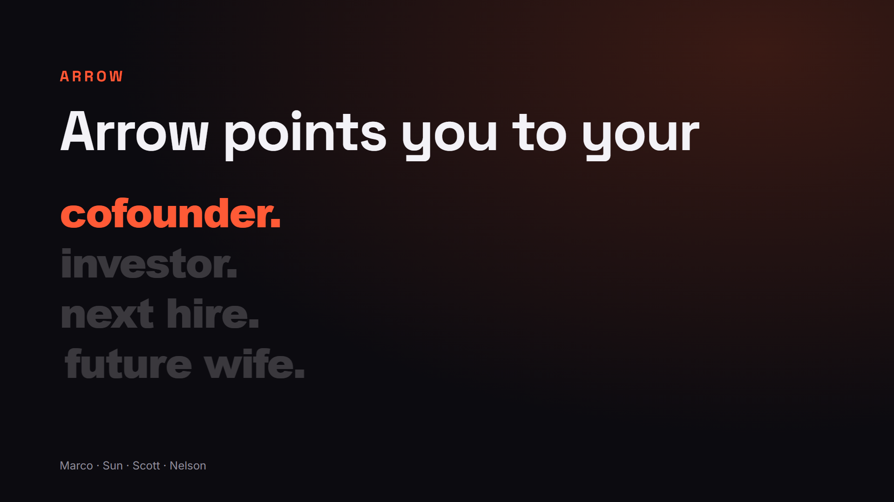
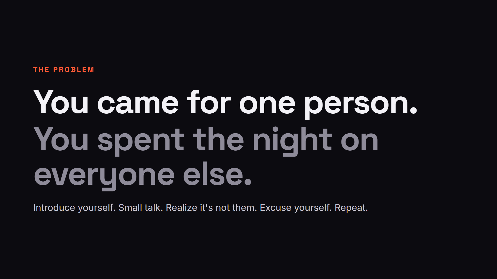
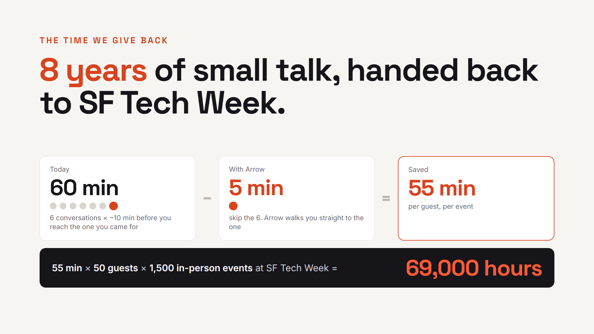
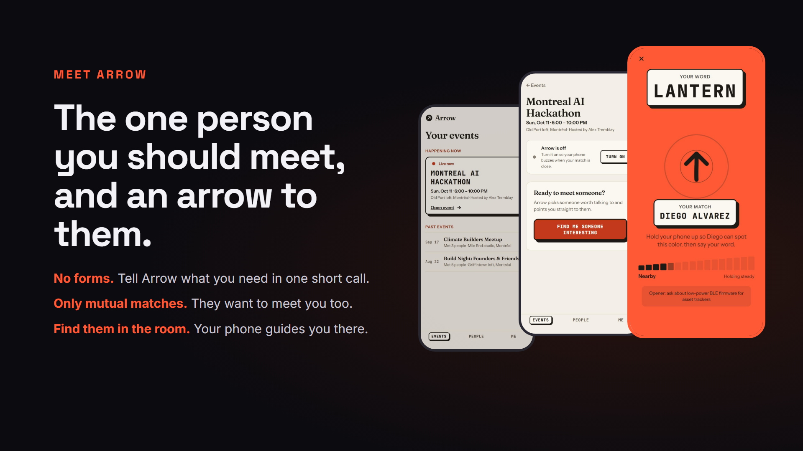
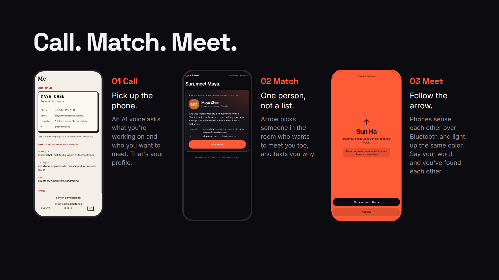
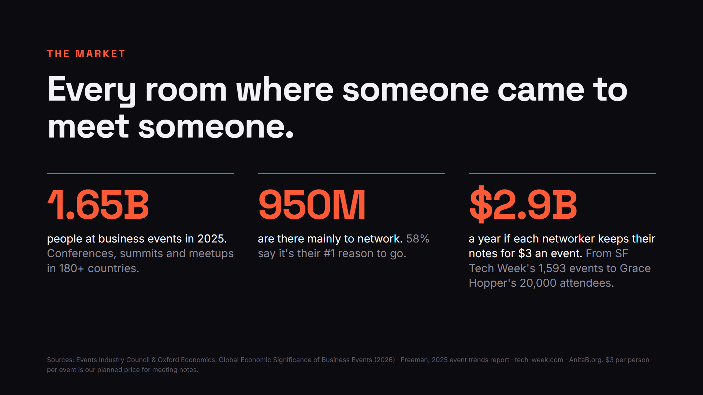

# Arrow pitch (SpeedHacks)

Six slides, then the live demo.

| | |
|---|---|
|  | **1. Arrow points you to your…** cofounder, investor, next hire, future wife (cycles live in `index.html`) |
|  | **2. The problem.** You came for one person; you spent the night on everyone else. |
|  | **3. The time we give back.** 60 min → 5 min per guest; ~8 years across SF Tech Week. |
|  | **4. Meet Arrow.** App screens: events, event page, finder. |
|  | **5. Call. Match. Meet.** One screen per step. |
|  | **6. Live demo.** |

- **Present:** open `index.html` in a browser and press `F` for full screen. → / Space / click the right side goes forward; ← / click the left third goes back. `#3` in the URL jumps to slide 3. Elements animate in and numbers count up on each slide.
- **Short version:** `short.html` (and `arrow-pitch-short.pdf`) is slides 1, 2, 3 and the demo handoff, for when the product is shown live in the app. It's generated from `index.html` by dropping slides 4–5, so edit `index.html` first and regenerate.
- **Static versions:** `index.html?all` shows every slide stacked (used for `arrow-pitch.pdf` and the `slide-N.png` exports).
- **Slide 2 sources (secondhand, via press/blog summaries):** 58% go mainly to network, and nearly half want to know who to meet before the event (Freeman, 2025 trends report, 2024 data). ~14 conversations per guest in an evening (Ingram & Morris, "Do People Mix at Mixers?", Columbia Business School).
- **Slide 3 math:** today you have ~6 conversations × ~10 min ≈ 60 min before you reach the one you came for (6 is well under the ~14 conversations per evening measured at Columbia). With Arrow ≈ 5 min, straight to them. Saved: 55 min per guest per event. × 50 guests (estimate) × ~1,500 in-person events ≈ 69,000 h ≈ 7.8 years.
- **Event count (verified Oct 11, 2026):** the official calendar's data at tech-week.com/calendar/sf reports `total: 1593` for SF 2026; per day: Oct 5: 187, Oct 6: 367, Oct 7: 407, Oct 8: 372, Oct 9: 156, Oct 10: 71, Oct 11: 33 (sums to 1,593). A sample of 321 events was ~6% virtual, so ~1,500 in person.
- **Guests per event:** Tech Week 2024 reported 2,000 events and 75,000+ attendees across SF, LA and NYC (~38 per event, secondhand). Big SF 2026 rooms had 400–1,000 registrations. 50 is our estimate.
- **App screenshots** (`img/app-*.jpg`) are from the Expo app on web at 390×844.
- **Web app (host dashboard + guest page):** https://arrow.sunisgreat1.workers.dev
